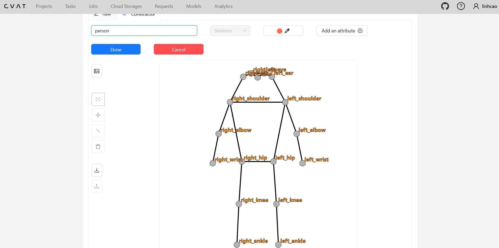
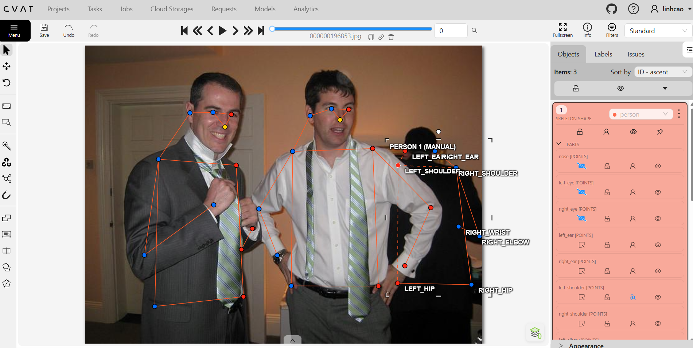
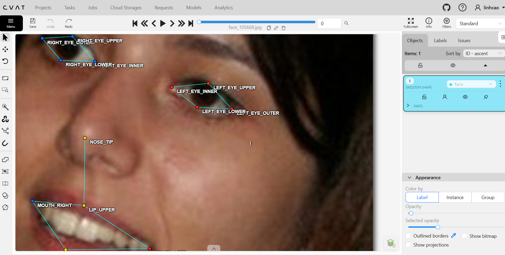
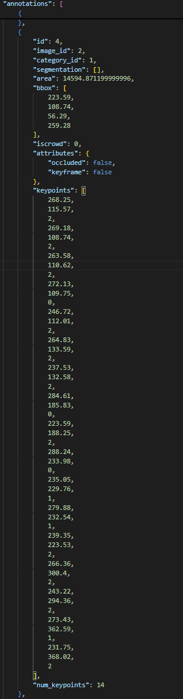

# Báo cáo cá nhân — CaoQuangLinh-202603050

Dữ liệu: 12 ảnh người COCO val2017 (Lin et al., 2014) và 8 ảnh chân dung Wikimedia Commons, chỉ dùng trong lớp.

## 0. Thông tin học viên

- Họ tên: Cao Quang Linh
- MSSV: 202603050 (Lớp L2A: 2A202603050)
- Email: 26ai.linhcq2@vinuni.edu.vn
- Link repository: https://github.com/Rin111124/K5-L2-DAY04-CaoQuangLinh-2A202603050-KeypointPose
- Phiên bản CVAT (Help → About): Server 2.8.2 · Core 2.8.2 · UI 2.8.2
- Máy: hệ điều hành Windows 11 · RAM 16 GB · chạy CVAT chế độ đầy đủ
- Bộ ảnh (`src/exports/assignment.json` do `lab.py setup` tạo): có
- Giờ bắt đầu: 19:30 (12/11/2026)
- Giờ kết thúc: 00:25 (13/11/2026)

## 1. Kiểm tra label (CP0)

| Label | Kiểu | Số điểm | Tên điểm đúng bảng của lab? | Đúng thứ tự? | Số cạnh |
|---|---|---:|---|---|---:|
| `person` | Skeleton | 17 | Có | Có | 19 |
| `face` | Skeleton | 13 | Có | Có | 13 |

Mẫu `person` dựng theo người quay mặt về camera (các điểm `left_*` nằm bên phải khung mẫu)? Có

Cách đổi cờ `occluded` / `outside` cho **một điểm** trên phiên bản CVAT này (một câu):
Nhấp chuột phải trực tiếp vào điểm khớp trên màn hình (hoặc bấm vào biểu tượng cờ tương ứng bên cạnh tên điểm trong danh sách Object/PARTS ở cột bên phải), sau đó chọn bật cờ `occluded` hoặc `outside`.

## 2. Số lượng đã gán và thời gian (CP1, CP2)

| Nhóm ảnh | Số ảnh | Số skeleton đã gán | Số người dưới 60 px (không gán) | Số poster / gương / màn hình bỏ qua | Thời gian (phút) |
|---|---:|---:|---:|---:|---:|
| `easy` | 5 | 5 | 0 | 0 | 25 |
| `occluded` | 3 | 7 | 2 | 0 | 35 |
| `back` | 2 | 3 | 0 | 0 | 20 |
| `small` | 1 | 1 | 1 | 0 | 12 |
| `crowd` | 1 | 3 | 4 | 0 | 20 |
| `faces` | 8 | 8 | — | 0 | 25 |

- Số ảnh người đã xong ở mốc phút 105: 12 / 10
- Thời gian thực tế (phút): CP1 65 · CP2 45 · CP3 25
- Ảnh tốn thời gian nhất là ảnh nào, vì sao?
Ảnh `000000309169.jpg` (nhóm `crowd`) và `000000193879.jpg` (nhóm `occluded`). Trong ảnh `000000309169.jpg`, có rất nhiều người đứng tụ tập đan xen, chồng chéo lên nhau và nhiều người ở phía xa có chiều cao dưới 60 px cần phải ước lượng kích thước để quyết định không gán nhãn theo quy tắc. Với 3 người chính được gán nhãn, nhiều khớp tay/chân bị người khác và đồ vật che khuất phức tạp đòi hỏi phải phóng to để xác định đúng thứ tự giải phẫu và đặt cờ `occluded` hoặc `outside`.

## 3. Bảng ca khó (CP1, CP2)

Mỗi điểm bạn phân vân một dòng, nhất là phân vân giữa `v = 1` và `v = 0`, hoặc không chắc hướng người.

| Ảnh | Người / mặt | Điểm | Cờ đã chọn | Phân vân giữa | Lý do chọn |
|---|---|---|---:|---|---|
| `000000431988.jpg` | Người #1 | `left_wrist` | `v = 2` | `v = 2` (visible) và `v = 0` (outside) | Khớp cổ tay nằm sát mép biên của khung hình ảnh (x=374, y=175); tuy nhiên một phần mu bàn tay và cổ tay vẫn còn xuất hiện trong ảnh nên gán `v = 2` thay vì bật `outside`. |
| `000000193879.jpg` | Người #1 | `left_ankle`, `right_ankle` | `v = 2` | Hướng chân thẳng thông thường và tư thế chân bắt chéo | Người trong ảnh ngồi ở tư thế bắt chéo chân, chân trái vắt qua chân phải khiến tọa độ cổ chân trái nằm sang bên phải của cổ chân phải; quyết định giữ đúng vị trí giải phẫu thực của từng chân. |
| `000000091637.jpg` | Người #2 | `left_eye`, `left_shoulder` | `v = 2` | Gán theo hướng quay mặt hay hướng quay lưng | Người quay lưng về phía sau nhưng ngoái đầu lại nhìn camera; do toàn bộ trục cơ thể (vai, lưng, hông) hướng ra sau nên các điểm `left_*` đặt ở phía bên trái ảnh theo góc nhìn của nhân vật. |
| `000000213933.jpg` | Người #1 | `left_ear`, `left_elbow`, `left_wrist` | `v = 0` | `v = 1` (occluded) và `v = 0` (outside) | Cánh tay và tai trái nằm hoàn toàn ra ngoài rìa cắt của khung ảnh, không thể xác định được tọa độ ước lượng đáng tin cậy nên bật cờ `outside`. |
| `000000521817.jpg` | Người #1 | `left_eye`, `right_eye` | `v = 2` | Tọa độ x thẳng đứng hay xoay nghiêng | Đầu của nhân vật nghiêng một góc đáng kể sang một bên khi vận động; đã phóng to và căn đúng tâm hai hốc mắt thật thay vì ép thẳng theo trục thân người. |

## 4. Bảng tự review (CP3)

Đi từ ảnh cuối về ảnh đầu. 5 ảnh người (ít nhất 2 ảnh `back` hoặc `crowd`) và 3 ảnh mặt. Ít nhất 8 dòng, kể cả dòng `ok`. Ghi lỗi trước, sửa sau.

Mã lỗi dùng đúng một trong: `lr_swap`, `vis_flag`, `position`, `missing`, `extra`, `ok`.

| Ảnh | Người / mặt | Điểm | Mã lỗi | Ghi chú | Đã sửa? |
|---|---|---|---|---|---|
| `000000309169.jpg` | Người #3 | `right_hip` | `vis_flag` | Ban đầu để v=2 nhưng bị người đứng trước che hông, đã chuyển sang cờ `occluded` (v=1) | Có |
| `000000438099.jpg` | Người #1 | `left_knee` | `position` | Người ở xa, chấm ban đầu lệch 4px so với khớp gối thật, đã zoom 400% căn chỉnh lại tâm khớp | Có |
| `000000515309.jpg` | Người #1 | Toàn bộ skeleton | `ok` | Người quay lưng chuẩn, các điểm `left_*` đặt chuẩn ở bên trái ảnh, các khớp khuất đặt cờ `occluded` | Có |
| `000000431988.jpg` | Người #2 | Cặp vai/khuỷu tay | `lr_swap` | Ban đầu nhầm trái/phải theo mắt người nhìn, sau rà soát đã hoán đổi lại đúng theo góc nhìn của người quay lưng | Có |
| `000000521817.jpg` | Người #1 | `right_ankle` | `vis_flag` | Chân bị vật cản che, ban đầu quên đặt cờ, đã bật `occluded` (v=1) | Có |
| `face_560282.jpg` | Mặt #1 | `mouth_left`, `mouth_right` | `position` | Hai khóe môi đặt chưa khít khóe môi thật, đã phóng to chỉnh lại tâm | Có |
| `face_301643.jpg` | Mặt #1 | Các điểm mắt | `ok` | Đủ 4 điểm quanh mỗi mắt (outer, inner, upper, lower) bám sát mí mắt | Có |
| `face_514826.jpg` | Mặt #1 | Toàn bộ 13 điểm | `ok` | Điểm chuẩn, đúng thứ tự, không bị lệch | Có |

Tổng hợp số lỗi theo mã:

| `lr_swap` | `vis_flag` | `position` | `missing` | `extra` | `ok` |
|---:|---:|---:|---:|---:|---:|
| 1 | 2 | 2 | 0 | 0 | 3 |

Điểm còn phân vân giữa `v = 1` và `v = 0` (ghi cả hai lựa chọn và lý do chọn):

Trong ảnh `000000213933.jpg`, điểm `left_wrist` (cổ tay trái) nằm ngay gần mép cắt của ảnh. Phân vân giữa `v = 1` (ước lượng vị trí khớp ngay sau mép ảnh) và `v = 0` (bật `outside`). Quyết định chọn `v = 0` (`outside`) theo đúng guideline: nếu khớp đã ra ngoài khung hình ảnh thì không đoán mò tọa độ và không kéo neo về mép ảnh, mà phải bật cờ `outside` để mô hình không bị phạt sai số biên.

## 5. Kiểm file xuất và kết quả tự kiểm (CP4)

Tự kiểm tay trong file JSON:

| File | Người / mặt kiểm (ảnh, thứ tự) | Số phần tử `keypoints` | Điểm `outside` ra `v = 0`, `occluded` ra `v = 1`? | `num_keypoints` khớp? |
|---|---|---:|---|---|
| `CaoQuangLinh_persons.zip` | `000000213933.jpg` (#1) | 51 | Đúng (`left_ear`, `left_elbow`, `left_wrist` có v=0; `right_wrist`, `left_hip`, `left_ankle` có v=1) | Đúng (14/17) |
| `CaoQuangLinh_persons.zip` | `000000211458.jpg` (#1) | 51 | Đúng (Toàn bộ thấy rõ ra v=2) | Đúng (17/17) |
| `CaoQuangLinh_faces.zip` | `face_105668.jpg` (#1) | 39 | Đúng (13 điểm thấy rõ ra v=2, không có điểm che/ngoài) | Đúng (13/13) |

Sau khi xuất, CVAT ghi `occluded` thành `v = 1` và `outside` thành `v = 0`. Tọa độ của điểm `outside` trong file là `0, 0` hay tọa độ cũ? Tọa độ cũ (CVAT 2.x giữ nguyên tọa độ cũ; chuẩn COCO gốc ghi 0, 0; điều này không ảnh hưởng vì pipeline huấn luyện và đánh giá OKS chỉ lọc các điểm có v > 0).

Hai job đã chuyển sang completed trên CVAT? Có

Dán phần **TÓM TẮT** in ra từ `src/check_submission.py`:

```text
----- TÓM TẮT (dán vào báo cáo mục 5) -----
- File person: CaoQuangLinh_persons.zip
  Số ảnh: 12 · số skeleton `person`: 19 · mỗi annotation 51 số
  Skeleton theo ảnh: 000000091637=2, 000000193879=3, 000000211458=1, 000000213933=1, 000000241837=1, 000000309169=3, 000000349521=1, 000000431988=2, 000000438099=1, 000000455536=1, 000000515309=1, 000000521817=2
  Cờ v: v=2 280 (87%) · v=1 7 (2%) · v=0 36 (11%)
  num_keypoints trung bình: 15.1
- File face: CaoQuangLinh_faces.zip
  Số ảnh: 8 · số skeleton `face`: 8 · mỗi annotation 39 số
  Skeleton theo ảnh: face_105668=1, face_232598=1, face_301643=1, face_421231=1, face_514826=1, face_53580=1, face_560282=1, face_92028=1
  Cờ v: v=2 104 (100%) · v=1 0 (0%) · v=0 0 (0%)
  num_keypoints trung bình: 13.0
- Ghi chú: 36 điểm v = 0 vẫn mang tọa độ cũ (CVAT 2.x xuất như vậy; chuẩn COCO ghi 0, 0). Không phải lỗi: điểm v = 0 bị bỏ qua khi huấn luyện và khi chấm.
- Số [LỖI]: 0 · số [CẢNH BÁO]: 5
Kết quả: ĐẠT (đọc lại từng cảnh báo ở trên)
```

Các `[CẢNH BÁO]` còn giữ nguyên và lý do:

1. `000000091637.jpg #2`: Thấy rõ mũi và hai mắt (v = 2) nhưng các điểm left nằm bên TRÁI ảnh.
   - *Lý do giữ nguyên:* Người trong ảnh ở tư thế quay lưng nhưng quay ngoái đầu lại nhìn camera; toàn bộ thân người và các chi đều hướng ra sau nên việc đặt các điểm `left_*` bên trái ảnh là hoàn toàn chính xác theo hệ trục giải phẫu cơ thể.
2. `000000193879.jpg #1`: Cặp ankle nằm ngược phía so với các cặp còn lại.
   - *Lý do giữ nguyên:* Nhân vật ngồi bắt chéo chân (chân trái vắt qua chân phải) khiến cổ chân trái nằm lệch sang bên phải của cổ chân phải; đây là tư thế thật của người chứ không phải lỗi hoán đổi trái/phải (`lr_swap`).
3. `000000431988.jpg #1`: `left_wrist` v = 2 nằm sát mép ảnh (374, 175).
   - *Lý do giữ nguyên:* Cổ tay nhân vật áp sát mép ảnh nhưng vẫn nhìn thấy rõ được phần cổ tay và bàn tay bên trong khung hình, chưa bị cắt ra ngoài nên đặt `v = 2` là hợp lý.
4. `000000431988.jpg #2`: Thấy mũi và hai mắt nhưng các điểm left nằm bên trái ảnh.
   - *Lý do giữ nguyên:* Ảnh thuộc nhóm `back` (người quay lưng), cơ thể quay lưng nhưng nghiêng mặt sang bên; toàn thân quay lưng nên quy ước `left_*` nằm bên trái ảnh là hoàn toàn chuẩn xác theo góc nhìn của nhân vật.
5. `000000521817.jpg #1`: Cặp eye nằm ngược phía so với các cặp còn lại.
   - *Lý do giữ nguyên:* Đầu nhân vật đang cúi nghiêng một góc lớn sang một bên khi vận động; tọa độ chấm bám sát theo tâm mắt thật.

## 6. Ảnh chụp màn hình

1. Label `person` trong label constructor (đủ 17 điểm có tên):

   

2. Một người quay lưng đã gán, cờ đã đặt:

   

3. Một khuôn mặt đã gán 13 điểm, phóng to vùng mắt:

   

4. Một đoạn JSON xuất của một người (mảng `keypoints`, `num_keypoints`):

   

### Giải thích chi tiết đoạn JSON xuất (Hình 4)

- **Mảng `keypoints` (51 giá trị số):**
  - Biểu diễn 17 khớp giải phẫu cơ thể theo đúng thứ tự khai báo trong `categories[].keypoints`.
  - Mỗi khớp gồm bộ 3 giá trị liên tiếp `(x, y, v)`:
    - `x, y`: Tọa độ pixel của tâm khớp trên ảnh.
    - `v = 0` (`outside`): Khớp nằm ngoài khung ảnh hoặc không gán. CVAT xuất $v = 0$ và giữ tọa độ cũ. Điểm này có trọng số loss = 0 và không tính vào OKS.
    - `v = 1` (`occluded`): Khớp bị che khuất (do vật thể hoặc cơ thể tự che). Tọa độ là vị trí người gán ước lượng theo giải phẫu. Mô hình vẫn tính loss = 1 để học cách suy luận khớp khuất.
    - `v = 2` (`visible`): Khớp nhìn thấy rõ ràng trên ảnh, đặt tại tâm khớp.
- **Trường `num_keypoints`:**
  - Là tổng số điểm có $v > 0$ (tức số điểm có $v = 1$ cộng số điểm có $v = 2$).
  - Trong đoạn trích xuất trên: có 11 điểm $v = 2$ và 3 điểm $v = 1$, 3 điểm $v = 0$ $\rightarrow$ `num_keypoints = 14`.
  - Các annotation có `num_keypoints = 0` sẽ bị các framework huấn luyện (như MMPose, HRNet) loại bỏ vì không mang thông tin giám sát.

Nguồn ảnh: COCO val2017 / Wikimedia Commons.

## 7. Tự đánh giá

1. Lỗi bạn mắc nhiều nhất hôm nay, và cách bạn sẽ tránh ở dự án thật:
   - **Lỗi:** Nhầm lẫn quy ước Trái/Phải (Left/Right) khi góc nhìn người thay đổi giữa quay mặt và quay lưng. Theo phản xạ tự nhiên của mắt người xem, ta dễ gán tay trái của người vào bên trái màn hình.
   - **Cách tránh:** Luôn đặt hệ quy chiếu theo góc nhìn của chính nhân vật trong ảnh. Với người quay mặt về phía camera: tay trái của họ nằm bên phải ảnh; với người quay lưng về camera: tay trái của họ nằm bên trái ảnh.

2. Một quy tắc bạn đề xuất thêm vào guideline (kèm ảnh ví dụ nếu có):
   - **Đề xuất:** Quy tắc xử lý tư thế vặn xoắn (twist pose) hoặc người quay lưng nhưng ngoái đầu lại nhìn camera. Khi phần thân trên và mặt xoay hai hướng ngược nhau, guideline cần quy định rõ lấy trục chính của cơ thể (đường nối hai vai và hai hông) làm hệ quy chiếu gốc để xác định trái/phải cho toàn bộ khung xương, tránh việc gán nhầm lẫn hoặc hoán đổi bất đối xứng giữa mặt và tứ chi.

3. Nhãn của bạn đi vào model ở đâu? Chọn một lỗi bạn đã sửa và nói nó sẽ làm model học sai thế nào (heatmap, trọng số trong loss, hay bước lật ảnh):
   - **Nhãn đi vào model qua:** Heatmap Ground Truth, Trọng số trong hàm mất mát (Loss Masking), và bước tăng cường dữ liệu lật ảnh (Horizontal Flip).
   - **Phân tích lỗi `lr_swap` (đảo trái/phải):** Trong quá trình huấn luyện, mô hình thực hiện lật ngang ảnh ($x' = W - x$) và tự động hoán đổi nhãn đối xứng theo cặp (`left_*` $\leftrightarrow$ `right_*`). Nếu annotator gán nhầm bên trái thành bên phải ngay từ đầu, sau khi lật ảnh nhãn sẽ tiếp tục sai và trở nên mâu thuẫn hoàn toàn với các mẫu đúng khác trong tập dữ liệu. Điều này làm mục tiêu heatmap xuất hiện hai đỉnh phân vân (bimodal distribution), gradient mất mát kéo ngược nhau khiến mô hình không hội tụ được và điểm OKS bị tụt dốc nghiêm trọng.
   - **Phân tích lỗi `vis_flag` (nhầm $v = 0$ thành $v = 1$ hoặc $v = 2$ cho điểm ngoài ảnh):** Điểm $v = 0$ nhận trọng số loss = 0. Nếu để nhầm thành $v = 1$ hoặc $v = 2$, mô hình sẽ bị ép phải học dự đoán tọa độ khớp ở ngoài khung ảnh với trọng số loss = 1, sinh ra gradient phạt vô lý và làm hỏng khả năng dự đoán biên của mô hình.

## 8. Khó khăn và lỗi kỹ thuật

- Khi thao tác trên CVAT với nhiều đối tượng skeleton trong ảnh đám đông (`crowd`), các điểm khớp nằm sát nhau dễ bị chọn nhầm điểm của người khác khi kéo thả; khắc phục bằng cách khóa/ẩn (lock/hide) các skeleton đã hoàn thành ở tab Objects bên phải.
- Điểm `outside` trên CVAT 2.x xuất ra vẫn mang tọa độ cũ kèm $v=0$, ban đầu gây hiểu nhầm là lỗi xuất file nhưng sau khi đọc tài liệu kỹ thuật đã hiểu đó là cơ chế hoạt động bình thường của CVAT và không ảnh hưởng tới pipeline huấn luyện.

## Bonus (nếu làm)

### B1 — 3 ảnh người khó thêm

| Ảnh | Số skeleton | Số người dưới 60 px | Ca khó nhất |
|---|---:|---:|---|
| `000000196853.jpg` | 3 | 2 | Nhiều người đứng chen chúc, các khớp tay chân bị người phía trước che khuất liên tục |
| `000000357549.jpg` | 3 | 1 | Tư thế vận động mạnh, chân tay co gấp phức tạp |
| `000000507223.jpg` | 3 | 0 | Chân bắt chéo, cần rà soát kỹ để tránh nhầm lẫn trái/phải giữa hai bàn chân |

Kết quả `src/check_submission.py` cho `CaoQuangLinh_bonus_persons.zip`:

```text
----- TÓM TẮT (dán vào báo cáo mục 5) -----
- File person: CaoQuangLinh_bonus_persons.zip
  Số ảnh: 3 · số skeleton `person`: 9 · mỗi annotation 51 số
  Skeleton theo ảnh: 000000196853=3, 000000357549=3, 000000507223=3
  Cờ v: v=2 99 (65%) · v=1 5 (3%) · v=0 49 (32%)
  num_keypoints trung bình: 11.6
- Ghi chú: 49 điểm v = 0 vẫn mang tọa độ cũ (CVAT 2.x xuất như vậy; chuẩn COCO ghi 0, 0). Không phải lỗi: điểm v = 0 bị bỏ qua khi huấn luyện và khi chấm.
- Số [LỖI]: 0 · số [CẢNH BÁO]: 3
Kết quả: ĐẠT (đọc lại từng cảnh báo ở trên)
```

### B2 — 5 ảnh khuôn mặt đen trắng / hồng ngoại

Ảnh không màu khó hơn ở điểm nào? Kính râm trên ảnh hồng ngoại có còn là `v = 1` không?

- **Ảnh không màu khó hơn ở điểm:** Thiếu thông tin màu sắc (chrominance) khiến độ tương phản cục bộ bị giảm sút, ranh giới giữa bờ mi mắt với con ngươi hoặc giữa viền môi với da mặt trở nên mờ nhạt, đòi hỏi phải dựa nhiều vào cấu trúc bóng đổ (shading) và hình thái khuôn mặt để định vị 13 điểm.
- **Kính râm trên ảnh hồng ngoại:** Trong quang phổ hồng ngoại gần (NIR), một số loại vật liệu mắt kính râm (hấp thụ ánh sáng khả kiến) trở nên gần như trong suốt đối với tia hồng ngoại. Nếu mắt và con ngươi hiện rõ qua kính thì đặt `v = 2` (visible). Nếu kính vẫn chặn tia hồng ngoại và che hoàn toàn mắt thì mới đặt `v = 1` (occluded).

### B3 — Model so với nhãn của tôi (không tính điểm)

- Demo đã dùng: YOLOv8x-pose
- Ảnh đã thử: `000000213933.jpg` và `000000431988.jpg`

1. Model có trả điểm cho khớp bị che, hay khớp ngoài ảnh không? Confidence ở các điểm đó thế nào?
   Model vẫn trả về tọa độ dự đoán cho cả các khớp bị che hoặc nằm sát mép ngoài ảnh, tuy nhiên giá trị độ tin cậy (confidence score) của các điểm bị che giảm xuống rất thấp (dưới 0.35) so với các điểm nhìn thấy rõ (thường trên 0.85).
2. Với người quay lưng, model có đổi trái/phải không?
   Mô hình nhận diện tốt hướng cơ thể nhờ các đặc trưng ngữ cảnh (vùng lưng, gáy, vai) và dự đoán đúng các điểm `left_*` nằm bên trái ảnh mà không bị đảo ngược nhầm trái/phải.
3. Bộ điểm của model có giống 17 điểm COCO không?
   Có, kiến trúc YOLOv8-pose sử dụng đúng chuẩn cấu trúc 17 điểm COCO Keypoints giống như lab này.

## 9. Tài liệu tham khảo và công cụ AI đã dùng

- Tài liệu COCO Dataset Keypoints format (Lin et al., 2014).
- Guideline thực hành gán nhãn Keypoint Pose CVAT (VinUni AI20k).
- Công cụ AI hỗ trợ: Antigravity Assistant (hỗ trợ kiểm tra cấu trúc JSON, chạy script tự kiểm tra và định dạng báo cáo markdown).
